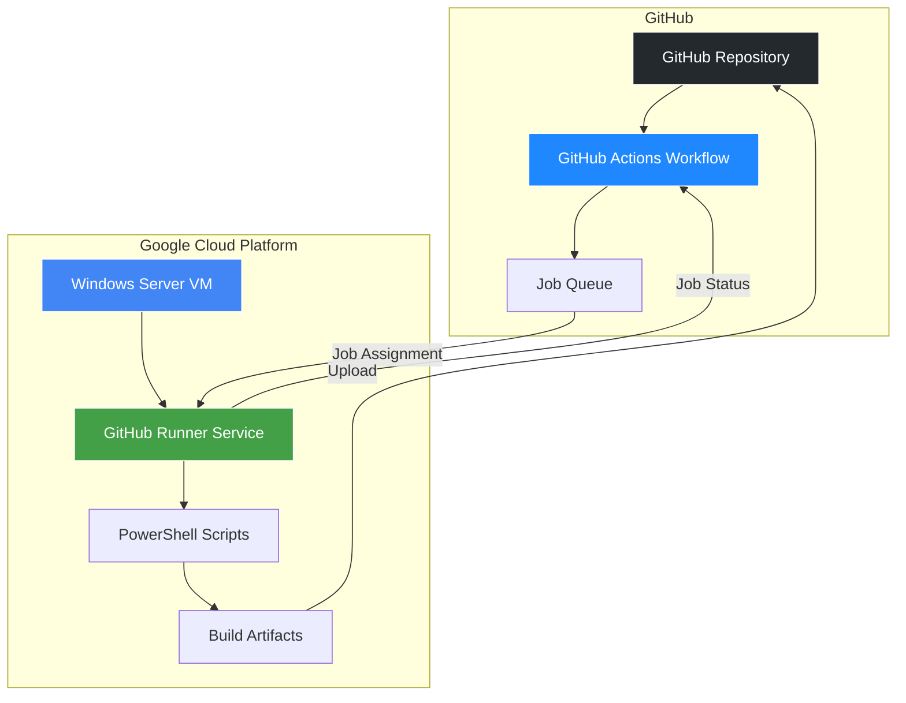
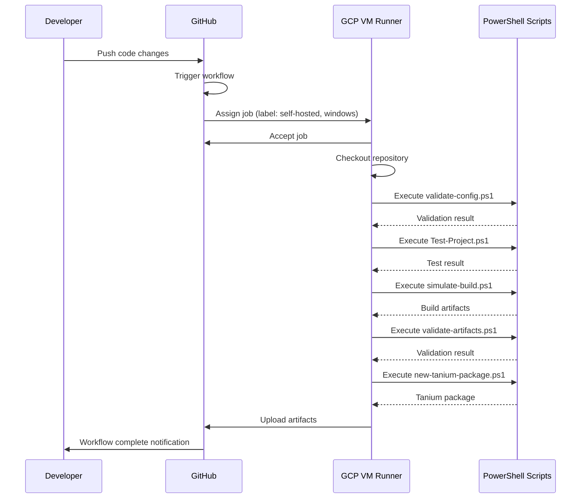
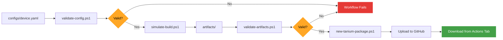
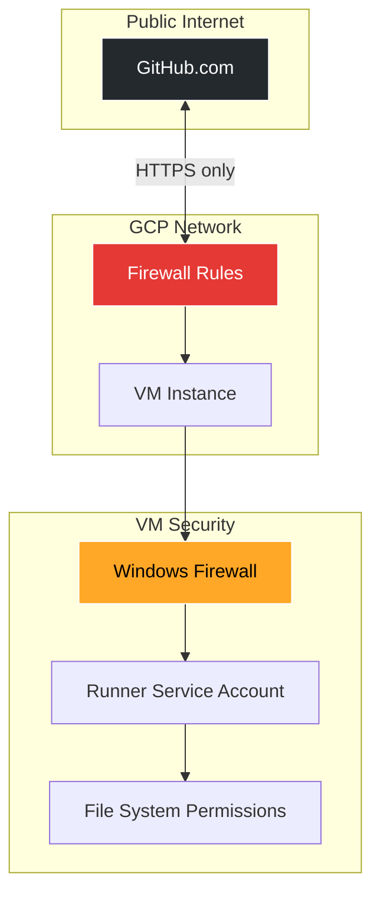
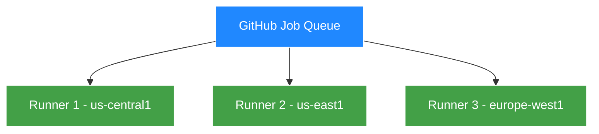

# Architecture Overview

This document explains how the self-hosted runner architecture works for the Windows Image Factory Demo.

## System Architecture



## Component Details

### GitHub Components

#### 1. Repository
- Stores source code, scripts, and configurations
- Hosts the workflow definition (`.github/workflows/image-factory.yml`)
- Receives and stores build artifacts

#### 2. GitHub Actions Workflow
- Defines the CI/CD pipeline
- Triggers on push, PR, or manual dispatch
- Queues jobs for execution

#### 3. Job Queue
- Matches jobs to available runners based on labels
- Ensures `[self-hosted, windows]` jobs go to your GCP VM

### GCP Components

#### 1. Windows Server VM
- **OS:** Windows Server 2022 Datacenter
- **Purpose:** Hosts the GitHub runner and executes workflows
- **Specs:** 2-4 vCPUs, 8-16 GB RAM, 50 GB disk

#### 2. GitHub Runner Service
- Windows service running 24/7
- Polls GitHub for jobs matching its labels
- Executes workflow steps in isolated environment

#### 3. PowerShell Scripts
- Configuration validation
- Image build simulation
- Artifact generation and validation
- Tanium package creation

#### 4. Build Artifacts
- Generated during workflow execution
- Uploaded back to GitHub for storage
- Downloadable from Actions tab

## Workflow Execution Flow



## Data Flow



## Network Communication

### Outbound Connections from GCP VM

| Destination | Port | Protocol | Purpose |
|------------|------|----------|----------|
| `github.com` | 443 | HTTPS | Job polling, code checkout |
| `api.github.com` | 443 | HTTPS | API requests |
| `*.actions.githubusercontent.com` | 443 | HTTPS | Artifact uploads |
| `*.blob.core.windows.net` | 443 | HTTPS | Action dependencies |

### Inbound Connections to GCP VM

| Source | Port | Protocol | Purpose |
|--------|------|----------|----------|
| Your IP | 3389 | RDP | Remote desktop access |

**Security Note:** GitHub never initiates connections to your runner. The runner always polls GitHub.

## File System Layout on Runner

```
C:\
├── actions-runner/              # Runner installation
│   ├── bin/                      # Runner binaries
│   ├── _diag/                    # Diagnostic logs
│   ├── _work/                    # Workspace for jobs
│   │   └── image-factory-demo/   # Cloned repository
│   │       ├── configs/
│   │       ├── scripts/
│   │       ├── tests/
│   │       └── artifacts/        # Build outputs
│   └── config files
```

## Security Architecture



### Security Layers

1. **GCP Firewall**
   - Blocks all inbound except RDP (3389)
   - Allows all outbound HTTPS (443)

2. **Windows Firewall**
   - Default deny inbound
   - Allows runner service outbound

3. **Runner Isolation**
   - Dedicated service account
   - Limited file system access
   - No admin privileges required for jobs

4. **GitHub Permissions**
   - Workflow has `contents: read` only
   - Cannot modify code without PR
   - No access to repository secrets (in simulation mode)

## Scaling Considerations

### Single Runner Setup (Current)

- **Capacity:** 1 job at a time
- **Cost:** ~$50/month (if running 24/7)
- **Best for:** Small teams, demo/test environments

### Multi-Runner Setup (Future)



- **Capacity:** 3 parallel jobs
- **Cost:** ~$150/month (if all running 24/7)
- **Best for:** Production environments, large teams

## Monitoring and Observability

### Where to Find Logs

| Component | Log Location | Access Method |
|-----------|--------------|---------------|
| Workflow execution | GitHub Actions tab | Web UI |
| Runner service | `C:\actions-runner\_diag\` | RDP to VM |
| PowerShell scripts | Console output in workflow logs | Web UI |
| GCP VM system | Cloud Console → Logging | Web UI |
| Windows Event Log | Event Viewer on VM | RDP to VM |

### Key Metrics to Monitor

- ⌚ **Job duration:** Should be 2-5 minutes for simulation
- 💾 **Disk usage:** Monitor `C:\actions-runner\_work\`
- 🧠 **Memory usage:** Should stay under 4 GB
- 💸 **GCP billing:** Check monthly spend

## Disaster Recovery

### Runner Failure

**Symptoms:** Runner shows offline, jobs stuck in queue

**Recovery:**
1. RDP to VM
2. Restart service: `.\svc.cmd restart`
3. If persistent, re-register runner

### VM Failure

**Symptoms:** Cannot RDP, runner offline for extended period

**Recovery:**
1. GCP Console → VM instances
2. Stop VM, then start
3. If boot failure, create snapshot and restore to new VM

### Complete Rebuild

**Estimated time:** 30 minutes

1. Follow [QUICK_START.md](QUICK_START.md)
2. Previous artifacts are safe in GitHub
3. No data loss (stateless runner)

## Cost Breakdown

### Monthly Cost Estimate (Running 24/7)

| Resource | Cost |
|----------|------|
| e2-standard-2 VM | $49.28 |
| 50 GB disk | $2.00 |
| Network egress (typical) | $1-5 |
| **Total** | **~$52-56/month** |

### Cost Optimization

**Option 1: Stop when not in use**
- Manual stop/start via GCP Console
- Cost: ~$2/month (storage only) + runtime hours

**Option 2: Scheduled start/stop**
- Use GCP Cloud Scheduler
- Example: Run 9 AM - 6 PM weekdays only
- Cost: ~$15-20/month

**Option 3: Spot/Preemptible VM**
- 60-91% cheaper than standard VMs
- May be interrupted with 30-second notice
- Cost: ~$12-20/month (if running 24/7)

## Performance Benchmarks

### Typical Workflow Execution Times

| Step | Duration |
|------|----------|
| Checkout | 5-10 seconds |
| Validate configuration | 2-3 seconds |
| Run smoke test | 5-10 seconds |
| Simulate image build | 30-60 seconds |
| Validate artifacts | 2-3 seconds |
| Generate Tanium package | 5-10 seconds |
| Upload artifacts | 5-15 seconds |
| **Total** | **~1-2 minutes** |

### Machine Type Comparison

| Machine Type | vCPUs | RAM | Workflow Time | Monthly Cost |
|--------------|-------|-----|---------------|-------------|
| e2-medium | 2 | 4 GB | ~3-4 min | $24.27 |
| e2-standard-2 | 2 | 8 GB | ~1-2 min | $49.28 |
| e2-standard-4 | 4 | 16 GB | ~1-2 min | $98.56 |

**Recommendation:** Start with `e2-standard-2` for best balance of performance and cost.

## References

- [GitHub Self-Hosted Runners Documentation](https://docs.github.com/en/actions/hosting-your-own-runners)
- [GCP Compute Engine Pricing](https://cloud.google.com/compute/pricing)
- [Windows Server on GCP](https://cloud.google.com/compute/docs/instances/windows)

---

**Next Steps:**
- Review [SELF_HOSTED_SETUP.md](SELF_HOSTED_SETUP.md) for setup instructions
- Read [README.md](README.md) for project overview
